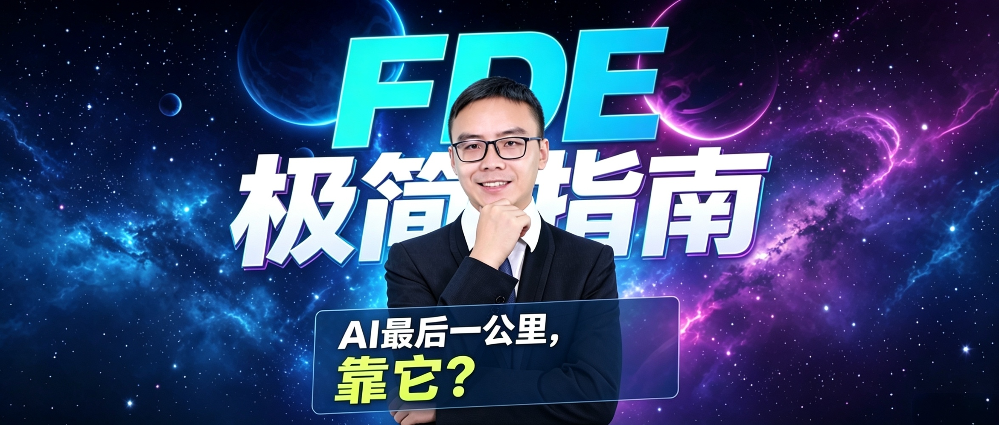

# cosmic-person-cover · 宇宙科技风人物封面

一句话生成"科技媒体感"的人物封面：**商务人物居中 + 超大主标题霓虹立体字压在人物背后 + 玻璃拟态副标题条压在人物身前 + 深蓝紫星空星云背景**。

同一套视觉语言，**同时支持横版和竖版**：

- 🖼 **横版**：公众号头图 / 知识·科技专栏封面 / 人物观点海报
- 📱 **竖版**：视频号 / 抖音 / 快手等短视频封面

---

## 效果预览



> 上方为横版样例：主标题"FDE极简指南"压在人物背后，副标题"AI最后一公里，靠它？"以玻璃拟态条压在人物身前，关键词"最后一公里"荧光黄高亮。

---

## 什么时候用

- 你只想好了**一个主标题 + 一个副标题**（可选再加一张人物照），要一张能直接发的封面图；
- 需要"知识类 / 科技类 / 观点类"栏目那种高对比、电影感、有辨识度的封面；
- 同一条内容要**横竖两版**（公众号发一篇，视频号/抖音再发一条）。

触发词：`宇宙风封面`、`星空封面`、`人物封面`、`公众号头图`、`横版封面`、`竖版封面`、`视频号封面`、`抖音封面`、`短视频封面`。

---

## 怎么用

### 最小用法（横版）

直接对助手说：

> 用宇宙风人物封面做一张公众号头图。
> 主标题：FDE极简指南
> 副标题：AI最后一公里，靠它？
> 高亮关键词：最后一公里

### 竖版（短视频封面）

> 用宇宙风人物封面做一张竖版短视频封面（视频号/抖音）。
> 主标题：FDE极简指南
> 副标题：AI最后一公里，靠它？
> 高亮关键词：最后一公里

### 带人物照（推荐）

把人物照一起发过来，并说明"这是本人，不要换脸"：

> 用宇宙风人物封面做一张横版头图，人物照见附件。
> 主标题：FDE极简指南 / 副标题：AI最后一公里，靠它？ / 高亮关键词：最后一公里

### 一次出两版

> 同一条内容，横版一张、竖版一张。

---

## 输入清单

| 项目 | 是否必填 | 说明 |
|---|---|---|
| 主标题 | ✅ 必填 | 压在人物背后的超大字，可中英混排，过长会自动拆两行 |
| 副标题 | ✅ 必填 | 压在人物身前的一句话，最有钩子的 3–6 个字会被荧光黄高亮 |
| 画幅 | ⭕ 可选 | 横版 / 竖版；不说明则默认**横版** |
| 人物照 | ⭕ 可选，强烈建议 | 商务半身照；给了就严格还原本人，不换脸不美化 |

---

## 画幅与尺寸

| 用途 | 画幅 | 建议尺寸 | 核心安全区 |
|---|---|---|---|
| 公众号头图 / 专栏封面 | 横版 2.35:1 | 2352×1000 | 中央约 1:1 方形 |
| 视频号 / 抖音 / 快手 视频封面 | 竖版 9:16 | 1080×1920 | 中央约 1:1 方形，上下留呼吸区 |
| 视频号 / 抖音 主页封面缩略图 | 竖版 3:4 | 1080×1440 | 同上 |

**为什么要居中？** 公众号头图在群聊/列表里会被裁成方形小缩略图；短视频封面则会被平台按钮（顶部昵称、底部进度条、右侧点赞按钮）遮挡。所以本 Skill 把人物、主标题、副标题**统统锁进画面中央的安全区**，两侧/上下只留星空背景——不管被怎么裁、怎么挡，主体和文字都完整可读。

---

## 视觉规则（每次都按这个来）

1. **人物**：半身居中、正面平视，边缘加蓝紫色轮廓光，与背景分离。
2. **主标题（后层）**：人物身后中上部的超大立体霓虹字，被人物肩颈部分遮挡；英文缩写青蓝霓虹发光，中文白色立体 + 蓝紫辉光。
3. **副标题（前层）**：人物身前下方的半透明深蓝玻璃拟态条，粗体无衬线，关键词荧光黄高亮。
4. **背景**：藏蓝→紫黑渐变星空，星云光晕、漂浮星点、一道弧形发光地平线光带，高对比电影感体积光。

---

## 可选配色变体

默认是**深空蓝紫**。想要别的调性，直接说：

| 变体 | 配色 |
|---|---|
| 墨绿+金 | 墨绿 / 暖金 / 米白 |
| 纯黑+橙 | 纯黑微星云背景，主标题橙红发光 |
| 冷白极简 | 冷白渐变背景，主标题深蓝立体 |

> 变体只改配色，横/竖画幅与安全区规则不变。

---

## 常见问题

**Q：副标题出现重复文字怎么办？**
模型偶尔会把钩子句渲染两遍。模板里已写死"整句只出现一次，分两行时第一行止于逗号、第二行不重复前文"；若仍出现，重生成一次即可。

**Q：人脸不像本人？**
务必把原始人物照作为参考图一起提供，模板会自动追加人脸锁定句（五官/眼镜/发型/表情完全一致）。

**Q：方形缩略图里字被裁掉了？**
说明核心元素越界了。让元素回到中央安全区、左右两侧只留星空即可。

**Q：竖版被平台按钮挡住字？**
画面顶部约 10%、底部约 18%、右侧中下部竖列区一律只留背景，核心元素往中央收。

---

## 目录结构

```
cosmic-person-cover/
├── SKILL.md                     # 技能定义（含横版/竖版双画幅说明）
├── README.md                    # 本文件：使用说明
├── 样例.jpg                      # 横版效果样例
└── references/
    └── prompt-template.md       # 横版/竖版图片生成提示词模板
```

---

## 安装到 WorkBuddy（可选）

把整个 `cosmic-person-cover/` 目录放到用户级技能目录即可全局可用：

```bash
cp -r /Users/luofei/Downloads/cosmic-person-cover ~/.workbuddy/skills/
```

之后在对话里说"用宇宙风人物封面做一张…"就会自动触发。
